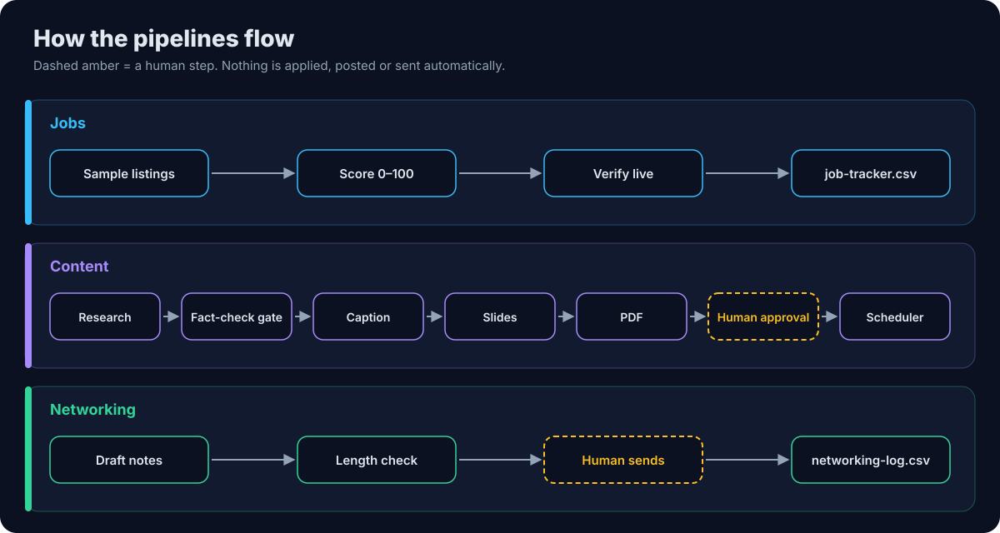
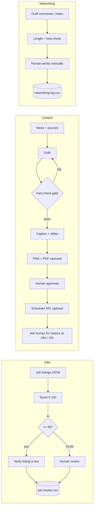
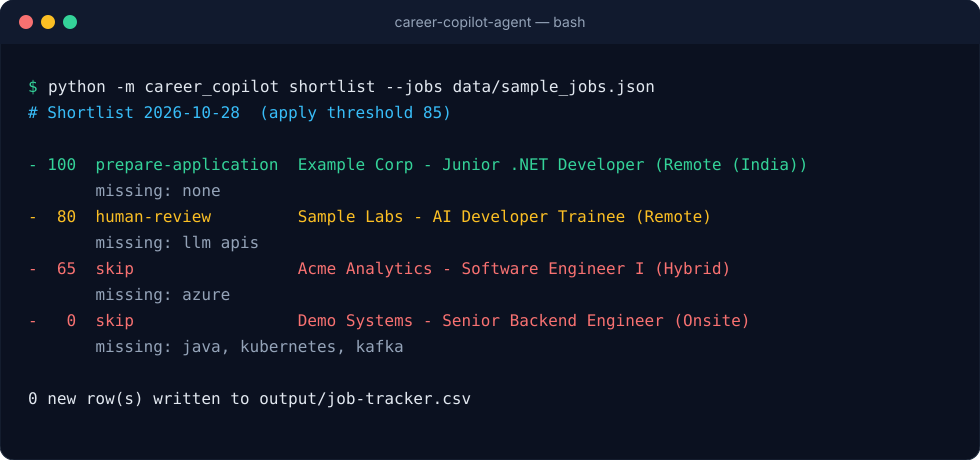
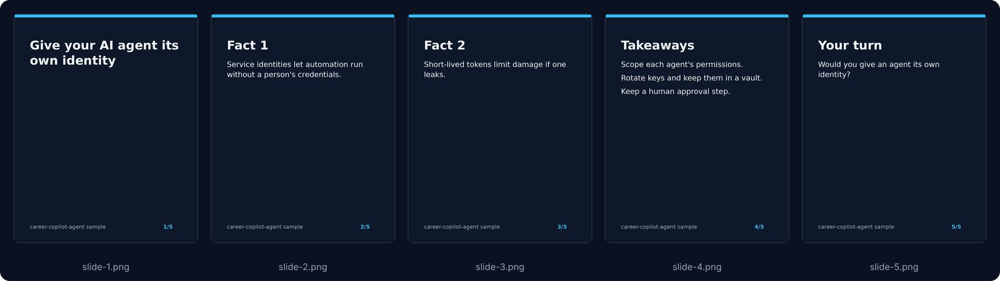
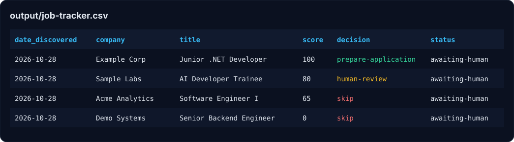
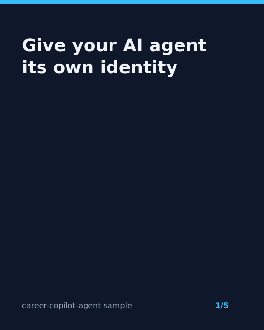

<p align="center"></p>

<p align="center">
  
  
  
  
</p>

# Career Copilot Agent

A human-in-the-loop pipeline for an early-career job search: it scores job listings,
keeps tracker CSVs tidy, and turns fact-checked news into a LinkedIn-ready caption and
PDF carousel. Every outward action (applying, posting, sending a note) stays with the human.

It grew out of a personal workflow I run daily. This repo is the cleaned-up, generic
version: synthetic sample data only, no personal records, no credentials.

## What it does

| Module | Job |
|---|---|
| `jobs.py` | Scores a listing 0-100 (skills 60, experience 20, location 20) with reasons and missing skills. 85+ and a verified-live listing -> "prepare application"; 70-84 -> human review. |
| `verify.py` | Plain HTTP check that an official listing page is still open. Unreachable = unverified, never "live". |
| `tracker.py` | CSV trackers with de-duplication, dated backups and a fixed set of statuses. |
| `content.py` | Draft -> fact-check gate (each claim needs a primary source or two independent domains) -> caption + slide outline. Also checks connection-note length. |
| `slides.py` | Renders 1080x1350 PNG slides and a multi-page PDF carousel with Pillow. |
| `scheduler.py` | Builds a payload for a third-party scheduler you already use; refuses to send unless the draft is approved. Computes the 24h/72h metric check-ins. |

## Demo

<p align="center"></p>

The animation loops through a real `shortlist` run on `data/sample_jobs.json`, then the slides the `post` command renders.

## Workflow

<p align="center"></p>

## Architecture



## Screenshots

All images are generated from real CLI output on the synthetic sample data (`python docs/make_assets.py`).

**Shortlist output**



**Rendered carousel (`output/post/slide-*.png`)**



**Job tracker CSV**



## Setup

```bash
git clone https://github.com/rohit-dev45/career-copilot-agent
cd career-copilot-agent
python -m venv .venv && source .venv/bin/activate
pip install -r requirements.txt
cp .env.example .env   # edit skills, locations, thresholds
pytest -q
```

## Usage

```bash
python -m career_copilot shortlist --jobs data/sample_jobs.json   # add --verify to HTTP-check URLs
python -m career_copilot post --draft data/sample_post.json --out output/post
```

Sample shortlist output:

```
- 100  prepare-application  Example Corp - Junior .NET Developer (Remote (India))
-  80  human-review         Sample Labs - AI Developer Trainee (Remote)
       missing: llm apis
```

Sample slide rendered from `data/sample_post.json`:



(Run the `post` command to get all PNG slides and `carousel.pdf` in `output/post/`.)

## Ethics and limits

- **Human in the loop.** The tool drafts and ranks; a person applies, posts and sends.
- **No LinkedIn automation.** It does not log in to, scrape, post to, or message on LinkedIn.
- **No scraping.** Listing checks are single HTTP requests to public, official job pages.
- **Facts before posting.** Drafts with unsourced claims fail the gate.
- **Privacy.** Trackers stay local (`output/` is git-ignored). Keep real data out of the repo.
- Drafting is template-based; there is a `Drafter` interface if you want to plug in an LLM.
  Scoring is rule-based, not a trained model.

## License

MIT
